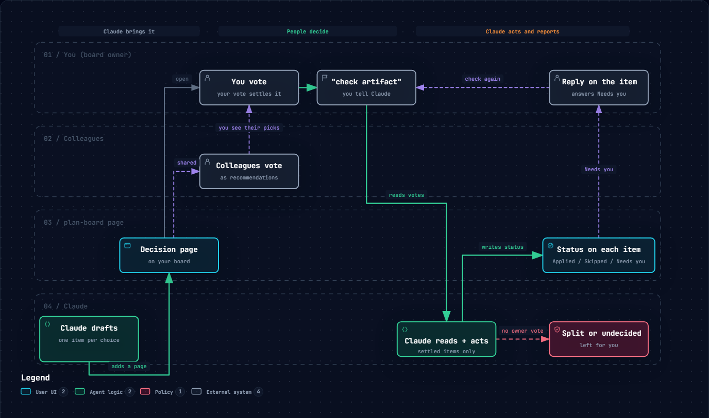

# plan-board

One shared board per project where Claude brings you decisions and you settle them. Claude puts the choices on the board with its suggestion on each, you and your team vote and comment, and when you say **check artifact** Claude acts on your picks and marks every item Applied, Skipped or Needs you.



## What you get

- **One board per project.** A private claude.ai Artifact that holds every decision for that project, with a dashboard of what's open, split, waiting on you and done.
- **Six kinds of decision:** pick one of a few options (with screenshots), compare options in a table, review findings (accept / reject / later), review a document's sections, yes or no, and confirm a process step by step. A decision can also carry a plan with a "you are here" step.
- **Votes under each person's name.** Only the board owner's vote settles an item; colleagues' votes show as recommendations, and disagreement shows as Split.
- **Claude reports back on each item:** what it did, or a question you answer right on the item.
- **Five looks** (Soft, Glass, Brutal, Editorial, Sketch), light and dark, phone and laptop. Each viewer picks their own.

## Install

### As a Claude Code plugin

In the Claude desktop app's **Code** tab: click **+** next to the prompt box, then **Plugins → Add plugin**, and add `SBI-sa/plan-board`.

In Claude Code in a terminal:

```
/plugin marketplace add SBI-sa/plan-board
/plugin install plan-board@plan-board
```

### As a plain download

Copy the `skills/plan-board` folder into your skills folder:

- Personal: `~/.claude/skills/plan-board/`
- One project only: `<project>/.claude/skills/plan-board/`

The folder has two files: `SKILL.md` (what Claude follows) and `hub.html` (the board page).

## Use it

1. Ask Claude for a decision, for example: *"Put the three homepage layouts on my plan board."* The first time, Claude publishes a new board for the project from `hub.html` and tells you its link.
2. Open the board, pick a verdict on each item, add a comment or a due date if it helps. Every click saves.
3. Tell Claude **check artifact**. It reads the votes, acts on the items you settled, and writes back Applied, Skipped or Needs you on each one. Split or undecided items are left for you.
4. If Claude asks something on an item, reply there and say **check artifact** again.

## Bring your team in

Open the board's **Share** menu and add each person as **Contributor**: they can vote and comment, and your vote settles each item. Viewers can only look. Someone who should also add decisions from their own Claude needs **Editor** access and this skill installed.

## Needs

A Claude plan with Artifacts that can store data (the board keeps decisions, votes and Claude's notes in its own small database). Boards are private until you share them.

## License

[MIT](LICENSE). The SBI name and logo are the maker's mark and are not covered by the MIT license; please keep them as they are or remove them, but don't use them for your own products.
